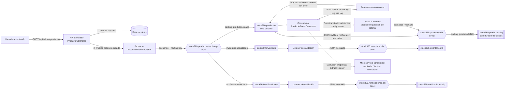

# Diseño de integración asíncrona con RabbitMQ en Stock360

**Asignatura:** DSY1107 – Desarrollo Cloud Native I
**Actividad:** Diseño de integración asíncrona con RabbitMQ
**Sistema:** Stock360 — gestión de inventario

## 1. Funcionalidad y necesidad

La funcionalidad seleccionada es la publicación y procesamiento de un evento cuando se crea un producto. El usuario autenticado registra el producto en Stock360; luego, el sistema emite `producto.creado` para que otros componentes puedan reaccionar al alta sin agregar su trabajo al flujo de la interfaz.

Esto permite incorporar tareas posteriores —por ejemplo, registrar una auditoría, actualizar un índice de búsqueda o solicitar una notificación— sin que el controlador tenga que invocar directamente cada componente. Si un consumidor no está disponible temporalmente, RabbitMQ conserva el mensaje en una cola durable hasta que pueda procesarlo.

**Estado actual y alcance:** Stock360 tiene un frontend React y un backend Spring Boot. El backend sigue siendo una aplicación modular única, no un conjunto de microservicios desplegados por separado. RabbitMQ está preparado para ejecutarse como clúster de dos nodos. La topología contiene tres colas durables y tres DLQ. El consumidor de productos valida el evento de producto; las colas de inventario y notificaciones son demostrativas y sus listeners solo validan objetos JSON y registran el evento. No se implementan acciones reales de inventario, auditoría ni envío de notificaciones.

## 2. Justificación arquitectónica

Una llamada HTTP síncrona desde el controlador a cada tarea posterior acoplaría la creación del producto con la disponibilidad y el tiempo de respuesta de todos esos componentes. Una falla o lentitud de una notificación, por ejemplo, podría demorar o impedir la respuesta al usuario aunque el producto ya se hubiera guardado.

Con RabbitMQ, el backend publica un evento y el consumidor lo procesa de forma independiente. El exchange `topic` enruta mensajes por claves descriptivas hacia tres colas durables. Cada cola tiene su propio exchange `direct` y su propia DLQ para aislar y revisar los mensajes rechazados.

RabbitMQ resulta adecuado porque Stock360 ya utiliza mensajería AMQP, necesita desacoplar el trabajo posterior a la creación y requiere reintentos y una cola de errores. REST sigue siendo apropiado para las consultas y operaciones que necesitan una respuesta inmediata —por ejemplo, validar y guardar el formulario—; no se propone reemplazar toda la API por mensajes.

La operación HTTP actual guarda primero el producto y luego publica el evento. Por tanto, el consumidor no bloquea la respuesta esperando completar el trabajo de negocio posterior, pero la solicitud sí depende de que el backend pueda publicar en RabbitMQ. No se ha implementado una transacción distribuida ni el patrón Outbox; esta limitación se detalla en la sección 5.

## 3. Diagrama del flujo

## 4. Componentes y recorrido del mensaje

| Elemento | Diseño en Stock360 |
| --- | --- |
| Función gatillante | La API recibe la creación de un producto en `POST /api/admin/productos`; el producto se guarda correctamente. |
| Productor | `ProductoEventPublisher`, invocado por `ProductoController` después de guardar. |
| Mensaje | JSON con `productoId` y `nombre`, por ejemplo: `{"productoId":42,"nombre":"Teclado"}`. No se envían credenciales ni el token del usuario. |
| Exchange principal | `stock360.productos.exchange`, tipo `topic`. Recibe eventos y permite agregar reglas/consumidores sin acoplarlos al productor. |
| Enrutamiento | Routing key `producto.creado`; binding de esa clave hacia `stock360.productos`. |
| Cola principal | `stock360.productos`, durable. Conserva el mensaje mientras el consumidor no lo recibe y tiene configurado el dead-letter exchange. |
| Consumidor | `ProductoEventConsumer`, actualmente un listener de Spring AMQP en el mismo backend. Deserializa, valida y registra el evento. Un consumidor separado para auditoría/notificaciones sería una evolución. |
| Resultado | Si el listener termina correctamente, el contenedor de Spring confirma el mensaje (ACK en modo automático). Si el mensaje es inválido, se rechaza sin reencolar y se deriva a la DLQ. |
| DLX y DLQ | `stock360.productos.dlx`, tipo `direct`, con routing key `producto.fallido`, enlazado a `stock360.productos.dlq`, durable. Los mensajes quedan disponibles para inspección o reenvío manual. |
| Colas adicionales de demostración | `stock360.inventario` (`inventario.actualizado`) y `stock360.notificaciones` (`notificacion.solicitada`). Sus listeners solo validan JSON y registran el evento. |
| DLQ adicionales | `stock360.inventario.dlq` y `stock360.notificaciones.dlq`, cada una enlazada a su propio exchange `direct` y routing key de fallo. |

El flujo, paso a paso, es:

1. El usuario envía el formulario autenticado al backend mediante HTTP. La autenticación y autorización de esta solicitud ocurren antes de la mensajería.
2. `ProductoController` valida la categoría y persiste el producto. Si la operación de persistencia falla, no se publica el evento.
3. Después del guardado, el productor serializa el identificador y el nombre y publica el JSON en el exchange con routing key `producto.creado`.
4. RabbitMQ aplica el binding y coloca el mensaje en `stock360.productos`. El backend responde al cliente con el producto creado; no espera a que termine un eventual trabajo de notificación o indexación del consumidor.
5. El listener consume el mensaje y valida que contenga identificador y nombre. Al finalizar correctamente, Spring AMQP envía el ACK y RabbitMQ elimina ese mensaje de la cola.
6. Si el mensaje no puede procesarse, se registra el error. Un mensaje inválido se rechaza sin reencolar; RabbitMQ lo enruta por el DLX a la DLQ para su análisis.

## 5. Errores, entrega y consistencia

- **Consumidor no disponible:** la cola durable mantiene los mensajes pendientes. Al volver a estar disponible el listener, continúa consumiéndolos. La topología duradera no sustituye una política de retención o respaldo operativo del broker.
- **Falla transitoria durante el procesamiento:** el listener tiene configurados reintentos, hasta tres intentos, con espera incremental. Si no logra procesarlo, el mensaje rechazado sin reencolar puede dirigirse a la DLQ. Los eventos malformados o incompletos se rechazan explícitamente y se registran, en lugar de reencolarlos indefinidamente.
- **Duplicados:** el broker puede entregar un mensaje más de una vez en ciertos escenarios de reconexión o confirmación. El consumidor actual solo valida y registra, por lo que no repite una modificación de negocio. Si se agregan efectos —como generar una notificación o guardar una auditoría—, deben ser idempotentes: incluir un `eventId` único y registrar su procesamiento para ignorar eventos ya aplicados.
- **Confiabilidad entre base de datos y broker:** actualmente el producto se guarda y luego se publica el mensaje, en dos operaciones distintas. Si RabbitMQ falla después del guardado, el registro puede existir aunque la publicación no se complete. Para garantizar publicación eventual en producción se recomienda el patrón **Transactional Outbox**: guardar el producto y el evento pendiente en una misma transacción local, y publicar/reintentar el evento desde un proceso dedicado. También se recomienda habilitar publisher confirms y alertas sobre el tamaño/antigüedad de la DLQ.
- **Operación de la DLQ:** la DLQ no tiene un consumidor automático; los mensajes permanecen disponibles para inspección y reenvío manual tras corregir la causa. Debe existir un procedimiento para revisar, reintentar de forma controlada o descartar mensajes.

## 6. Decisiones y límites de la propuesta

La implementación existente demuestra el recorrido del evento de producto, el enrutamiento y el rechazo a su DLQ. También configura dos colas demostrativas adicionales, cada una con listener de validación y DLQ propia. No se afirma que hoy existan microservicios separados, que se modifique inventario ni que se envíen notificaciones. Para evolucionar a esa arquitectura, los consumidores pueden extraerse a servicios independientes y sus tareas concretas deben definirse según una necesidad real del negocio. Las consultas y el CRUD continúan usando REST porque requieren respuestas inmediatas; RabbitMQ se reserva para trabajo posterior y desacoplable.

### Referencias del proyecto

- `Backend/src/main/java/com/example/Backend/controller/ProductoController.java`
- `Backend/src/main/java/com/example/Backend/messaging/ProductoEventPublisher.java`
- `Backend/src/main/java/com/example/Backend/messaging/ProductoEventConsumer.java`
- `Backend/src/main/java/com/example/Backend/messaging/ProductoCreadoEvent.java`
- `Backend/src/main/java/com/example/Backend/config/RabbitMqConfig.java`
- `Backend/src/main/resources/application.properties`
